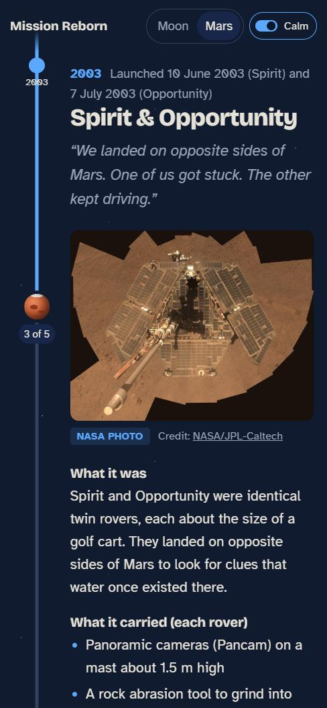

# Mission Reborn

**Abandoned But Not Forgotten**

Ten machines were left on the Moon and Mars. Mission Reborn tells what each one did, what it carried, and where it is now.

Made for [NASA Space Apps 2026: Abandoned but not Forgotten](https://www.spaceappschallenge.org/2026/challenges/nasas-discarded-equipment-storytelling/). The site is written for readers aged 11–14.

## What you can do

- Choose the Moon or Mars. The "o" in **Moon** or the "a" in **Mars** on the button turns into a spinning planet, which carries you into that world.
- Scroll through five machines in launch order. The small planet on the timeline rolls left as you scroll down and right as you scroll up.
- Follow the timeline, jump to a year, and take a quiz after each machine.
- Take a five-question quiz at the end of each planet. "Read it again" and the button for the other planet both glide back to the top first.
- After finishing both worlds, take the Final Mission. A victory screen names you a **Mission Reborn Explorer**, and the badge then sits at the top of the home page.
- Read the fun facts on the home page, and open the NASA pages we used from its Resources list.
- Tap a dotted word, such as seismometer, to see what it means. The `?` button in the top bar shows a short how-to guide, which also opens once on your first visit.
- Use the read-aloud button or turn on Calm mode. Calm mode reduces the large animations and is on by default when the device asks for reduced motion.

## The machines

| Moon | Launch year | Mars | Launch year |
|---|---:|---|---:|
| Surveyor 3 | 1967 | Viking 1 lander | 1975 |
| Apollo 11 “Eagle” descent stage | 1969 | Sojourner (Mars Pathfinder) | 1996 |
| Apollo 12 ALSEP science station | 1969 | Spirit & Opportunity | 2003 |
| Apollo 15 Lunar Roving Vehicle | 1971 | InSight lander | 2018 |
| LCROSS | 2009 | Ingenuity Mars Helicopter | 2020 |

## Run the site

There is no build step. To preview it locally:

1. Download or clone the project.
2. Open the folder in VS Code and install the Live Server extension.
3. Right-click `index.html` and choose **Open with Live Server**.

You can also open `index.html` directly. The site still works if the GSAP CDN is unavailable, but its larger animations will not run.

## Website

The planned GitHub Pages address is <https://hempatelv6-beep.github.io/Mission-Reborn/>. It will work after the repository is renamed to `Mission-Reborn` and GitHub Pages is enabled. Check [TODO_VERIFY.md](TODO_VERIFY.md) for the remaining setup.

## Project files

| File | Purpose |
|---|---|
| `index.html`, `styles.css`, `app.js` | Page, layout, and behavior |
| `data/moon.js`, `data/mars.js`, `data/final.js` | Machine facts and quiz questions |
| `images/` | Saved images and site screenshots |
| [PRD.md](PRD.md) | What the site should do |
| [ARCHITECTURE.md](ARCHITECTURE.md) | How the site files fit together |
| [DATA_GUIDE.md](DATA_GUIDE.md) | How to edit machine and quiz data |
| [SOURCES.md](SOURCES.md) | NASA pages used for facts |
| [IMAGE_CREDITS.md](IMAGE_CREDITS.md) | Image sources and labels |
| [AI-USE.md](AI-USE.md) | How AI was used on the project |
| [TODO_VERIFY.md](TODO_VERIFY.md) | Items still to review |

## Team

| Role | Work |
|---|---|
| Researcher 1 | Moon machines M1–M3 |
| Researcher 2 | Moon machines M4–M5 and quiz questions |
| Researcher 3 | Mars machines R1–R3 |
| Researcher 4 | Mars machines R4–R5 and quiz questions |
| Builder | Timeline, machine sections, and quiz interface |
| Producer | Images, project files, submission, and demo |

Add the team members' names before submitting. Researchers should have someone else check their machine cards.

## Credits

- Facts: NASA Science and the NASA Space Science Data Coordinated Archive. See [SOURCES.md](SOURCES.md).
- Images: NASA, NASA/JPL, and NASA/JPL-Caltech. See [IMAGE_CREDITS.md](IMAGE_CREDITS.md). NASA does not endorse this project.
- Animation: [GSAP](https://gsap.com/). Fonts: Fredoka and Nunito, served by Google Fonts. Moon and Mars pictures supplied by the team; astronauts and asteroids drawn in code (see [IMAGE_CREDITS.md](IMAGE_CREDITS.md)).
- Sounds: three real NASA recordings, listed in [AUDIO_CREDITS.md](AUDIO_CREDITS.md). The checkpoint chime is made in the browser.

## New in this version

- A brighter home page: big outlined title, "Fun facts" and "Resources" buttons, and two wide cards for the Moon and Mars.
- A checkpoint after every machine: finish its quiz to get a short victory card and chime, and a tick on the timeline. Turn sounds off with the Sound switch.
- Real NASA recordings for Apollo 11, InSight and Ingenuity. See [AUDIO_CREDITS.md](AUDIO_CREDITS.md).
