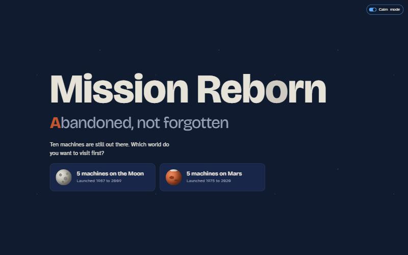

# Mission Reborn: Abandoned, not forgotten

Ten machines humans left on the Moon and Mars. What each one was, what it carried, what happened to it, and where it is now.

Built for **NASA Space Apps 2026**, challenge [Abandoned but not Forgotten](https://www.spaceappschallenge.org/2026/challenges/nasas-discarded-equipment-storytelling/). For readers aged 11-14.

## How it works
1. **Pick a world.** The title reads "Mission Reb**o**rn: **A**bandoned, not forgotten". Click the Moon and the "o" grows into the Moon. Click Mars and the "A" turns into Mars.
2. **Scroll the timeline.** Five machines, in launch order. A small planet slides down a line on the left. The line turns blue behind you and stays gray ahead, with a dot and a year for each machine and a "3 of 5" counter. Click a dot to jump.
3. **Every machine, same order:** real NASA photo with its credit and label, what it was, what it carried, what happened to it, where it is now, and the NASA pages we used.
4. **Quizzes.** "Check your knowledge" after each machine (3 questions), a planet quiz at the end (5), and a Final Mission once both worlds are done (10). That's 13 quizzes. Every answer is explained, and there's no failing.
5. **Read it again** sends the planet swinging back to the top while the blue line rewinds.
6. Finish the Final Mission to earn the **Mission Reborn Explorer** badge.

Also: a Read aloud button on every machine, and **Calm mode** (top right), which turns off the big animations. It's on automatically if your computer is set to reduce motion.

## The 10 machines
| Moon | Launched | Mars | Launched |
|---|---|---|---|
| Surveyor 3 | 1967 | Viking 1 lander | 1975 |
| Apollo 11 "Eagle" descent stage | 1969 | Sojourner (Mars Pathfinder) | 1996 |
| Apollo 12 ALSEP science station | 1969 | Spirit & Opportunity | 2003 |
| Apollo 15 Lunar Roving Vehicle | 1971 | InSight lander | 2018 |
| LCROSS | 2009 | Ingenuity Mars Helicopter | 2020 |

## Run it on your computer
Nothing to install except an editor.
1. Download or clone this repo.
2. Open the folder in [VS Code](https://code.visualstudio.com/) and install the **Live Server** extension.
3. Right-click `index.html` and pick **Open with Live Server**. Edit, save, and the page refreshes.

Double-clicking `index.html` also works, because the data files are `.js`, not `.json`. Animations need an internet connection for GSAP; without it the site still works, just without them.

## Live site
After the repo is renamed to `Mission-Reborn` and GitHub Pages is turned on (Settings → Pages → Deploy from a branch → `main`, `/ (root)`), the link will be:

https://hempatelv6-beep.github.io/Mission-Reborn/

The repo is still called `Last-Signal-NASA-` right now, so this link won't work until it's renamed.

## Project files
| File | What's in it |
|---|---|
| `index.html`, `styles.css`, `app.js` | The whole site |
| `data/moon.js`, `data/mars.js`, `data/final.js` | All facts and all 13 quizzes |
| `images/` | NASA images saved in the repo, plus screenshots |
| [PRD.md](PRD.md) | What we're building and how we know it's done |
| [ARCHITECTURE.md](ARCHITECTURE.md) | How the files connect |
| [DATA_GUIDE.md](DATA_GUIDE.md) | How to add or fix a machine or quiz without touching code |
| [SOURCES.md](SOURCES.md) | Every NASA page we used |
| [IMAGE_CREDITS.md](IMAGE_CREDITS.md) | Every image, its credit, and whether it's a real photo |
| [AI-USE.md](AI-USE.md) | How we used AI |
| [TODO_VERIFY.md](TODO_VERIFY.md) | Things still to double-check |

## Team
| Role | Job |
|---|---|
| Researcher 1 | Moon machines M1-M3 |
| Researcher 2 | Moon M4-M5 + quiz questions |
| Researcher 3 | Mars machines R1-R3 |
| Researcher 4 | Mars R4-R5 + quiz questions |
| Builder | Site: timeline, machine sections, quiz box |
| Producer | Images, repo files, submission, demo |

Each researcher checks someone else's machines, never their own. (Add names here before submitting.)

## Credits
- Facts: NASA Science and the NASA Space Science Data Coordinated Archive (NSSDCA). Full list in [SOURCES.md](SOURCES.md).
- Images: NASA, NASA/JPL, NASA/JPL-Caltech. See [IMAGE_CREDITS.md](IMAGE_CREDITS.md). NASA doesn't endorse this project.
- Animation: [GSAP](https://gsap.com/). Fonts: Bricolage Grotesque and Atkinson Hyperlegible (Google Fonts).
