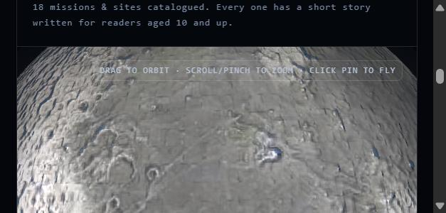
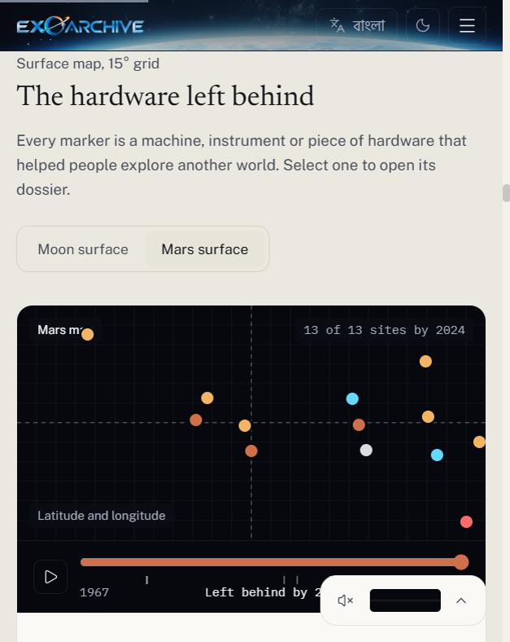
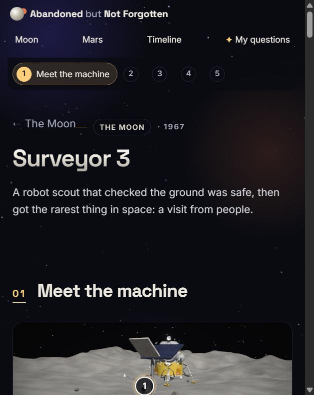
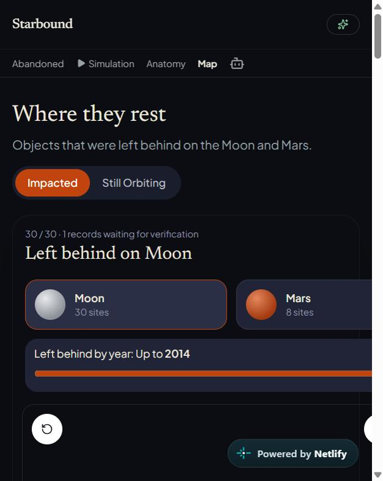
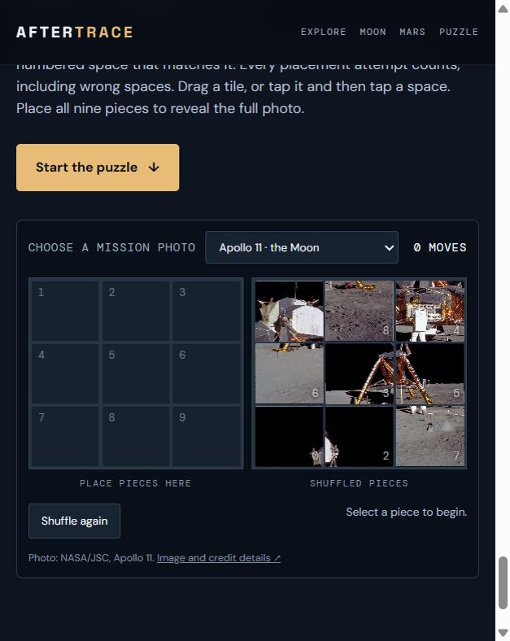
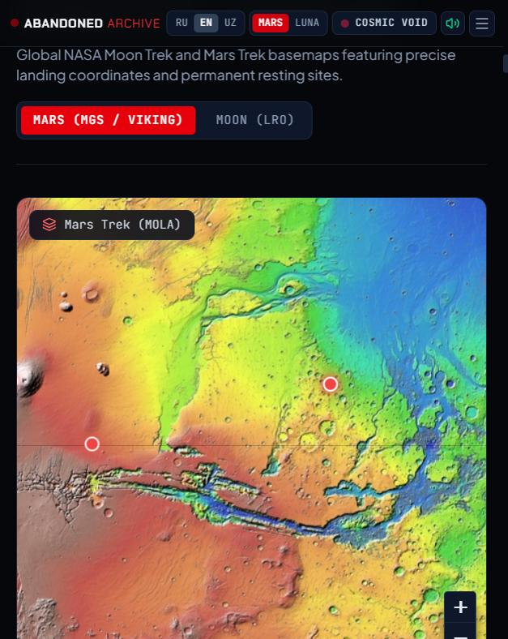
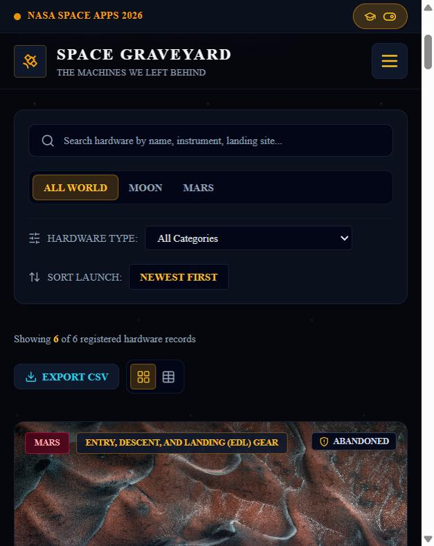

# Reference Website Research (1–10), focused on a 2D website

*Research date: 10–12 Nov 2026. Research only, no code.*

## Context
You asked for a full, per-website breakdown of the reference sites: every machine, the data shown for each, every feature, how features connect, where the data and images come from, and what a **2D** site could adapt. No links were included in your message, so this covers the same **top 10 reference sites** as before.

- **Verified (✔):** I opened the site in the browser (10 and 12 Nov 2026) or read the project's own data file in its GitHub repo.
- **README (≈):** taken from the project's README; I didn't see it working on screen.
- **Assumption (?):** my best guess.

Screenshots are in `research/screenshots/`. There are none for #5 (opening it was declined) or #8 (3D only). Coding waits until your team has chosen its features.

### Browser tabs open now (left → right)
| Tab | # | Site |
|---|---|---|
| 1 | #1 | Left Behind |
| 2 | #2 | EXOARCHIVE |
| 3 | #3 | 5-chapter stories |
| 4 | #4 | StarBound (map page) |
| 5 | #6 | AFTERTRACE |
| 6 | #7 | Comic site |
| 7 | #9 | Abandoned Archive (UZ) |
| 8 | #10 | SPACE GRAVEYARD |
| 9 | #8 | Unity game |
| — | #5 | CUỘI: **opening it was declined in the browser**, so it's covered from my earlier visit and its README |

---

## Quick list (1–10)

| # | Website | Repo | Machines | 2D-relevant? | Best thing to learn |
|---|---|---|---|---|---|
| 1 | [Left Behind](https://prismane1269.github.io/leftbehind/) | [repo](https://github.com/Prismane1269/leftbehind) | 18 | Partly (globe is 3D; data and story are 2D-friendly) | One story card format used everywhere |
| 2 | [EXOARCHIVE](https://abandoned-not-forgotten-omega.vercel.app) | [repo](https://github.com/jahidhasan75/Abandoned-Not-Forgotten) | 20 | **Yes**: its main map is 2D | 2D map + year slider + side panel |
| 3 | [5-chapter stories](https://abandonednotforgotten.vercel.app) | [repo](https://github.com/Perfectreviewer/abandoned-but-not-forgotten) | 7 | Story yes; globe and models are 3D | Same 5 chapters for every machine |
| 4 | [StarBound](https://starbound-tribute-to-abandoned-rovers.netlify.app/) | [repo](https://github.com/tayyab011/Spaceappschallenge2026) | 40 on map, 58 stories | **Yes**: the map is 2D | Status filters, "approximate" labels, bookshelf |
| 5 | [CUỘI](https://light-of-memories.vercel.app) | [repo](https://github.com/VuLeCoder/Light-of-Memories) | 3–4 | Yes (2D pixel game) | A guide character + a journal that fills in |
| 6 | [AFTERTRACE](https://rasan-omed144.github.io/AfterTrace-Space-Graveyard/) | [repo](https://github.com/Rasan-Omed144/AfterTrace-Space-Graveyard) | ~12 | **Yes**: fully 2D | Photo puzzle; question headings |
| 7 | [Comic site](https://tamnya.github.io/abandoned-but-not-forgotten/) | [repo](https://github.com/Tamnya/abandoned-but-not-forgotten) | ~15 (55 facts) | **Yes**: fully 2D | Fact IDs with "proof cards" |
| 8 | [Unity game](https://agneay-community-hub.github.io/AbandonedNotForgotten/) | [repo](https://github.com/Agneay-Community-Hub/AbandonedNotForgotten) | 1 | ✖ 3D only | The "go find the machine" idea |
| 9 | [Abandoned Archive](https://forgotten.marsdot.uz) | [repo](https://github.com/zufqqq-web/AbandonedNASA) | ~15 | **Yes**: Leaflet 2D map | Marker popup → dossier |
| 10 | [SPACE GRAVEYARD](https://space-graveyard.vercel.app) | [repo](https://github.com/samiulislam66200-alt/space-graveyard) | 6 | **Yes**: 2D | Filters + charts (design life vs. actual life) |

---

## #1 Left Behind: [site](https://prismane1269.github.io/leftbehind/) · [repo](https://github.com/Prismane1269/leftbehind)

*Screenshot: Explorer: globe and machine list (the 2D version would be a flat map) (12 Nov 2026, narrow browser window).*
**About ✔:** a scroll story (Earth → Moon → Mars) plus a catalogue of every machine, written for ages 10+.

**Machines ✔** (from `js/data.js`, 19 records):
- **Moon (6):** Surveyor 1, Surveyor 3, Apollo 11 "Eagle", Apollo 12 "Intrepid", Apollo 15 "Falcon" (+ LRV-1), Apollo 17 "Challenger" (+ LRV-3)
- **Mars (10):** Viking 1, Viking 2, Pathfinder + Sojourner, Spirit, Opportunity, Phoenix, InSight, Ingenuity, Curiosity *(active)*, Perseverance *(active)*
- **Deep space (2):** Voyager 1, Voyager 2
- **Earth (1):** Kennedy Space Center LC-39 (the starting point)

**Info per machine ✔:** name, type, world, latitude/longitude, site name, landing date, last contact, status (silent / retired / active / travelling), mass, power, **headline**, short story, 3 science bullets, "left behind" list, legacy, stats, gallery, NASA sources.

**Features ✔:**
- **Flight scroll:** text follows your scroll while the 3D view moves between waypoints. Has a Balanced/Calm motion setting.
- **Hall:** 6 machines drawn in code that you can rotate (3D).
- **Explorer:** a globe with tabs for Moon / Mars / Earth / Deep space and a list beside it. Click → card showing status, landed date, last heard, coordinates and the **live Earth distance and radio delay** (worked out in your browser).
- **Listening room:** a marsquake trace (InSight Sol 1222), Ingenuity's last downlink, and a "call Voyager 1" button with the real delay.
- **Timeline:** vertical, by year (1966 → today). Each entry has a title, 2–3 sentences and name chips you can click.
- **Catalogue page** (`catalog.html`) and an **About & sources** page.

**How they connect ✔:** hero → flight → hall → explorer → card → **one shared story popup**. The timeline chips and the hall open the same popup.

**Sources ✔:** NASA mission pages (links in each record); planet surface images from Solar System Scope (CC BY 4.0, based on NASA data); distances calculated in the browser. No live data calls.

**For our 2D site:**
- Use the same record fields.
- Keep the status labels and the "last heard" date.
- Turn the radio delay into plain text ("a message takes 11 minutes").
- Build a year timeline with clickable names.

## #2 EXOARCHIVE: [site](https://abandoned-not-forgotten-omega.vercel.app) · [repo](https://github.com/jahidhasan75/Abandoned-Not-Forgotten)

*Screenshot: 2D surface map with the "left behind by year" slider (12 Nov 2026, narrow browser window).*
**About ✔:** a museum-style archive of NASA hardware in English and Bangla. It works on slow internet and offline.

**Machines ✔** (from `public/data/objects.geojson`, 20 records):
- **Moon (7):** Apollo 11 "Eagle" descent stage, LRV-001, ALSEP stations *(inactive)*, Surveyor 3, Apollo 11 retroreflector *(active)*, Apollo 17 "Challenger" + rover, Apollo 14 S-IVB rocket impact crater
- **Mars (13):** Sojourner, Opportunity, Spirit, Phoenix, InSight, Viking 1, Viking 2, Mars Polar Lander *(lost)*, Ingenuity *(inactive)*, Curiosity *(active)*, Perseverance *(active)*, **Opportunity's heat shield**, **Perseverance's backshell + parachute**

**Info per machine ✔:** name, mission, world, lat/lon, year left behind, last contact, status (SILENT / HISTORIC / INACTIVE / ACTIVE / LOST), why it was left, science it enabled, image + credit + NASA image ID, and **catalogue IDs** (NSSDCA dataset ID, PDS ID, NTRS report ID and URL).

**Features ✔:**
- **2D surface map:** a NASA mosaic with a 15° grid. Moon/Mars toggle. **"Left behind by [year]" slider (1967–2024)**. Click a marker → side panel (catalogue code, coordinates, years, status reason, summary, 3 science bullets) → "Open the full dossier".
- **3D globes** (separate section): a Moon/Mars/Earth list that rotates the globe to the chosen site.
- **One machine, one journey:** a 6-stage timeline per machine (Launch → Touchdown → First drive → Science → … → Silence). Each stage has a fact box and sources.
- **Before/after slider:** drag to compare InSight's clean panels (2018) with its dusty panels (2022).
- **Still talking (live):** the latest Curiosity and Perseverance images and their sol numbers. Each value is labelled LIVE / CACHED / OFFLINE COPY.
- **Your turn:** a 5-question quiz that explains each answer and links to the dossier; Match the machine; **Where did it land?** (tap the map to score); Send a signal; Build a mission; For teachers.
- Language toggle and light/dark theme.

**How they connect ✔:** hero → map or globe → marker → panel → dossier ↔ journey; quiz answers → dossier.

**Sources ✔:** NSSDCA Master Catalog, the Planetary Data System (PDS), the NASA Technical Reports Server (NTRS), the NASA Image and Video Library, NASA Trek and GIBS map mosaics, mars.nasa.gov raw images (live), the JPL Horizons API (live distances), and APOD (`DEMO_KEY`).

**For our 2D site (strongest match):**
- A flat map with a side panel.
- A year slider.
- A per-machine journey timeline.
- Quiz feedback that links back to the story.
- Count landing debris as machines.

## #3 Five-chapter stories: [site](https://abandonednotforgotten.vercel.app) · [repo](https://github.com/Perfectreviewer/abandoned-but-not-forgotten)

*Screenshot: Story page with the 5-chapter progress bar (12 Nov 2026, narrow browser window).*
**About ✔:** a story site for ages 10–15. Each machine gets a 5-chapter story that ends with a question for the reader.

**Machines ✔** (`src/data/objects.json`, 7):
- **Moon:** Apollo 11 retroreflector *(still working)*, Apollo LRV, Surveyor 3
- **Mars:** Sojourner, Opportunity, InSight
- **Epilogue:** Voyager 1

**Info per machine ✔:** character line, purpose, mission text, discoveries (each with a NASA image + ID), 3 hotspots, **confirmed / inferred / unknown** lists, an open question, next-mission choices, teacher prompts, sources, and **`verifiedBy`** (the teammate who checked it).

**Features ✔:**
- Moon and Mars pages with a 3D globe (gold dots at real coordinates) and story cards.
- Story page with a chapter progress bar: Meet → Mission → Discovered → Rests → Question.
- **"My questions":** a constellation of your answers, saved in the browser.
- Timeline from 1967 to 2022.
- A teacher page with a printable 30-minute lesson.
- About & sources.

**Issues ✔:** chapters 3 and 5 were blank when I visited, the timeline showed only 1 entry, and the facts are marked "Draft".

**Sources ✔:** NASA Image Library (`images-assets.nasa.gov`), NASA 3D Resources, nasa.gov pages.

**For our 2D site:**
- A chapter template and progress bar.
- Confirmed / scientists think / unknown.
- A `verifiedBy` field.
- A teacher page.

## #4 StarBound: [site](https://starbound-tribute-to-abandoned-rovers.netlify.app/) · [repo](https://github.com/tayyab011/Spaceappschallenge2026)

*Screenshot: Map page: status filters, Moon/Mars toggle, year slider (12 Nov 2026, narrow browser window).*
**About ✔:** a Kids mode (mascot "Orbit", comic, voice) and an Adult mode (stories, map, 3D, recovery ideas).

**Machines ✔:**
- **Map** (`data/objects.geojson`, 40):
  - Moon 31: all 6 Apollo descent stages, Apollo 15 LRV, Surveyors 1–7, Rangers 7–9, Lunar Orbiters 1–5, GRAIL A & B, LADEE, Lunar Prospector, 5 ALSEP stations
  - Mars 8: Viking 1 & 2, Sojourner/Pathfinder, Spirit, Opportunity, InSight, Phoenix, Mars Polar Lander
  - Plus Cassini (solar system)
- **Story shelf (58 volumes):** the above, plus Mariner 2 & 5 (Venus), Mariner 10 (Mercury), Mariners 4/6/7/9, Mars Global Surveyor, Mars Observer, the Viking orbiters, Pioneer 5/10/11, Apollo 10 "Snoopy", Cassini and Deep Space 1.

**Info per machine ✔ (map):** name, mission, agency, world, lat/lon, year left behind, last contact, **why it was left**, science enabled, image + credit, dataset ID, **verified flag**, location state, last known location, hardware, current status, source URL.

**Features ✔:**
- **2D map:** Moon/Mars toggle, **status filters** (Impacted / Still orbiting), a "left behind by year" slider, zoom buttons and a list. Unsure positions are labelled "(Appx)" or "draft coordinates".
- **Abandoned Stories:** a bookshelf of 58 spines → click one → a 4-page book with Prev/Next.
- **Kids story:** a scrolling comic with glossary stars, auto-voice, badges and career cards.
- 3D mission view, rover anatomy (3D Perseverance), a Recovery ideas page (optional Firebase), an offline mode (`?offline=1`).

**How they connect ✔:** separate pages (Map, Stories, Simulation, Anatomy) share a top menu. Map items link to stories by `story_id`.

**Sources ✔:** JPL Photojournal (PIA IDs), NASA Image Library, NSSDCA, PDS, NASA Trek map tiles, HiRISE, a NASA/JPL 3D model, and NASA 3D models on Sketchfab.

**For our 2D site:**
- Status filter chips.
- "Approximate" location labels.
- A `why_left` field.
- The bookshelf-style picker.
- A `verified` flag.

## #5 CUỘI / Light of Memories: [site](https://light-of-memories.vercel.app) · [repo](https://github.com/VuLeCoder/Light-of-Memories)
**About ≈ / ✔ (earlier visit):** a 2D pixel game (Phaser) next to a companion book. Vietnamese with an English toggle.

**Machines ≈:** Surveyor 3, the Apollo 11 site (with the ALSEP / passive seismometer), and LRO (an orbiter that is still working).

**Features ≈:**
- Walk a character between machines.
- Mini-tasks such as matching memories and **comparing two real photos**.
- The book fills in as you progress and can be exported as a PDF.
- Music and sound effects; a visitor counter.

**Sources ?:** assumed to be NASA images. Not confirmed this time because the site wasn't opened.

**For our 2D site:**
- A guide character.
- A "journal" that fills in as you play.
- A "compare two photos" task.

## #6 AFTERTRACE: [site](https://rasan-omed144.github.io/AfterTrace-Space-Graveyard/) · [repo](https://github.com/Rasan-Omed144/AfterTrace-Space-Graveyard)

*Screenshot: 9-tile NASA photo puzzle (12 Nov 2026, narrow browser window).*
**About ✔:** a one-page "field guide" to everything left behind, including footprints and debris.

**Machines ✔:**
- **Moon:** the Apollo 11 "Eagle" descent stage, 5 more descent stages, the experiment stations (ALSEP, switched off in 1977) and retroreflectors (still used), the Soviet Lunokhods, bootprints and equipment, and ascent stages that are not on the ground.
- **Mars:** the Pathfinder lander + Sojourner, Spirit and Opportunity (with their final stops), the sky crane + heat shield + backshell, InSight, scattered Viking landing gear, and parachutes and impact marks.

**Features ✔:**
- Choose a world (photo cards) → that world's field guide (question headings).
- Real photos with "View NASA source ↗" links.
- **Photo puzzle:** choose 1 of 4 NASA photos → place 9 tiles (drag or tap) → move counter → finished photo and credit.

**Sources ✔:** NASA/JSC Apollo photos, the NASA Apollo landing sites page, NASA's catalogue of lunar artifacts, and NASA lunar laser ranging pages.

**For our 2D site:**
- Question-style headings.
- The photo puzzle (easy in 2D).
- A "What did the landing leave?" idea.

## #7 Comic site: [site](https://tamnya.github.io/abandoned-but-not-forgotten/) · [repo](https://github.com/Tamnya/abandoned-but-not-forgotten)

![Comic fact card with a fact ID ([F-013]) and image credit](screenshots/07-comic-fact-ids.jpg)
*Screenshot: Comic fact card with a fact ID ([F-013]) and image credit (12 Nov 2026, narrow browser window).*
**About ✔:** comic "issues" in a cockpit style (Moon, Mars, Deep Space, Why It Matters), written as "incoming transmissions".

**Machines ✔ (from `facts.json`, 55 facts):**
- **Moon:** the Apollo 11/14/15 retroreflectors, Apollo 12 + Surveyor 3, the Apollo LRVs, ALSEP
- **Mars:** Sojourner, Spirit, Opportunity, Curiosity *(active, "as of" date)*, Viking, InSight, Ingenuity
- **Deep space:** Voyager 1 & 2, Pioneer 10 & 11

**Info per fact ✔:** an ID (`F-001`…), chapter, character, adult text, **kid text**, a numeric value, the source, and an "as of" date when it can change.

**Features ✔:**
- Transmission cards, each with a fact ID and an **"Open proof card"** button.
- **Almanac:** every source and fact, linked both ways.
- My Collection: stickers you find around the site, with a printable certificate.
- An Arcade game (fictional, not about the science).
- Optional sound, off by default.

**Sources ✔:** `sources.json` (title, publisher, URL, access date). Primary sources: NASA pages, NSSDCA, NASA History, and NTRS. Images: PIA12922, PIA22210, PIA01959.

**For our 2D site:**
- Fact IDs with a proof link.
- **Two text versions** for each fact (kid and adult).
- "As of" dates for facts that can change.

## #8 Unity game: [site](https://agneay-community-hub.github.io/AbandonedNotForgotten/) · [repo](https://github.com/Agneay-Community-Hub/AbandonedNotForgotten)
**About ✔:** a 3D flight game. Pick a ship, fly from Earth (planet positions for today's date) to Mars, and find Opportunity. It takes about 20 seconds to load.
- **Machines ✔:** Opportunity only.
- **README ≈:** x-ray parts view and a traverse map from Eagle crater to Perseverance Valley.
- **Sources ≈:** NASA/JPL 3D models, JPL planet positions, Solar System Scope textures.
- **For our 2D site:** only the idea, a mission to "find the machine". **Not suitable for 2D.**

## #9 Abandoned Archive (Uzbekistan): [site](https://forgotten.marsdot.uz) · [repo](https://github.com/zufqqq-web/AbandonedNASA)

*Screenshot: Leaflet 2D map with NASA Mars Trek tiles and markers (12 Nov 2026, narrow browser window).*
**About ✔:** a catalogue + map + games in RU, EN and UZ.

**Machines ✔:**
- **Mars (11):** Opportunity, Spirit, Ingenuity, InSight, Sojourner, Phoenix, Curiosity *(active)*, Perseverance *(active)*, Viking 1, Viking 2, Mars Polar Lander
- **Moon:** Surveyor 3, the Apollo 11 descent stage, LRV-001
- **"Heritage" items:** jettison bags, golf balls, the Fallen Astronaut figure, Charlie Duke's family photo

**Info per machine ✔:** type, year, site name, precise coordinates, distance travelled, status, summary, dossier.

**Features ✔:**
- **Leaflet 2D map** with NASA Trek tiles: Moon/Mars buttons, zoom, a "sector objects" list. Click a marker → popup (type, year, site, coordinates) → "Open mission dossier".
- **Timeline:** 14 numbered items (1967–2021); click → detail card.
- The Last Signal, a Radio signal delay section, and a **Restore connection** game (pick a craft → tune the frequency → time the uplink).
- A 5-question quiz with a score.

**Issues ✔:** some Russian text appears in English mode; it claims "100% protected monuments"; it lists active rovers as permanent.

**Sources ✔:** NASA Trek tiles, the NASA Image Library API, LROC/HiRISE images (per its README).

**For our 2D site:**
- Marker popup → dossier.
- A numbered timeline with a detail card.

## #10 SPACE GRAVEYARD: [site](https://space-graveyard.vercel.app) · [repo](https://github.com/samiulislam66200-alt/space-graveyard)

*Screenshot: Explorer: search, Moon/Mars filter, type dropdown, CSV export (12 Nov 2026, narrow browser window).*
**About ✔:** a data-explorer style site (Next.js) with 7 sections.

**Machines ✔ (6 data files):**
- **Moon:** the Apollo 11 "Eagle" descent stage, Apollo 15 LRV-001, Surveyor 3
- **Mars:** Opportunity, InSight, Perseverance landing gear

**Info per machine ✔:** launch date, landing date, last communication, mission length (days and sols), distance travelled, mass, instruments, cause of silence, final location + coordinates, discoveries, images + credits, dataset links.

**Features ✔:**
- **Explorer:** search, Moon/Mars filter, hardware-type dropdown, sort, CSV export, cards with a "Why it matters" fact.
- **The Last Signal:** a fixed 5-field registry with a "carrier tone" button.
- **4 charts:** design life vs. actual life, distance driven, InSight power loss, instruments carried.
- Learn mode (K-12 explainers, glossary, quiz) and Sources.

**Issues ✔:** some invented-sounding "telemetry" (for example, a "last communication" date for the Eagle descent stage). The hero looked blank on load.

**Sources ✔ / ≈:** NASA/JPL pages, PDS, the Apollo Lunar Surface Journal.

**For our 2D site:**
- A **"planned vs. actual life" bar chart** (simple and powerful).
- A search box and filter, but only once you have 10+ machines.

---

## What a 2D site can realistically take

| Idea | From | Difficulty |
|---|---|---|
| Flat NASA map + dots + side panel | #2, #9 | Easy–medium |
| Status badges + "why it was left" | #1, #2, #4 | Easy |
| Per-machine journey timeline | #2 | Easy |
| Same chapters for every machine | #3 | Easy |
| Quiz feedback that links to the story | #2 | Easy |
| Match the machine / Where did it land? | #2 | Medium |
| Photo puzzle | #6 | Medium |
| Fact proof links + kid text | #7 | Easy |
| Planned vs. actual life bars | #10 | Easy |
| Year slider + status filters on the map | #2, #4 | Medium |

**Skip for 2D:** 3D globes and models (#1, #2, #3, #4), Unity (#8), live APIs (#2), Firebase (#4).

## Verification
- ✔ items were seen in the browser or read from each repo's data file.
- ≈ items come from READMEs.
- #5 wasn't reopened because the browser request was declined.
- After approval, the only changes will be `research/reference-websites.md` and `research/screenshots/*.png`.
